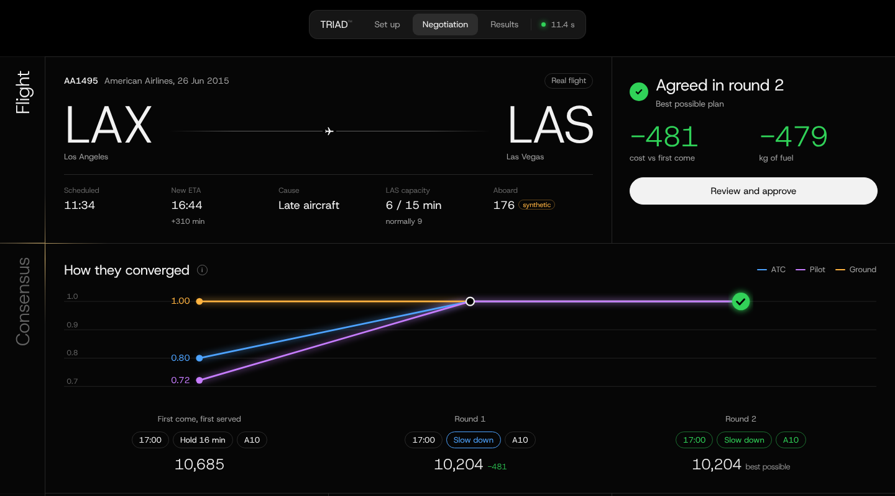
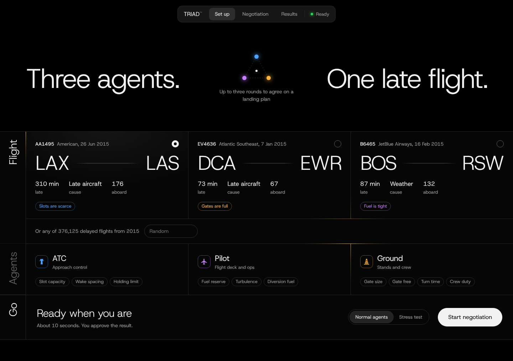
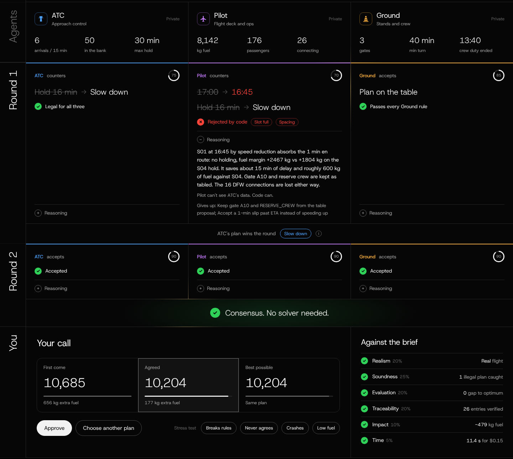
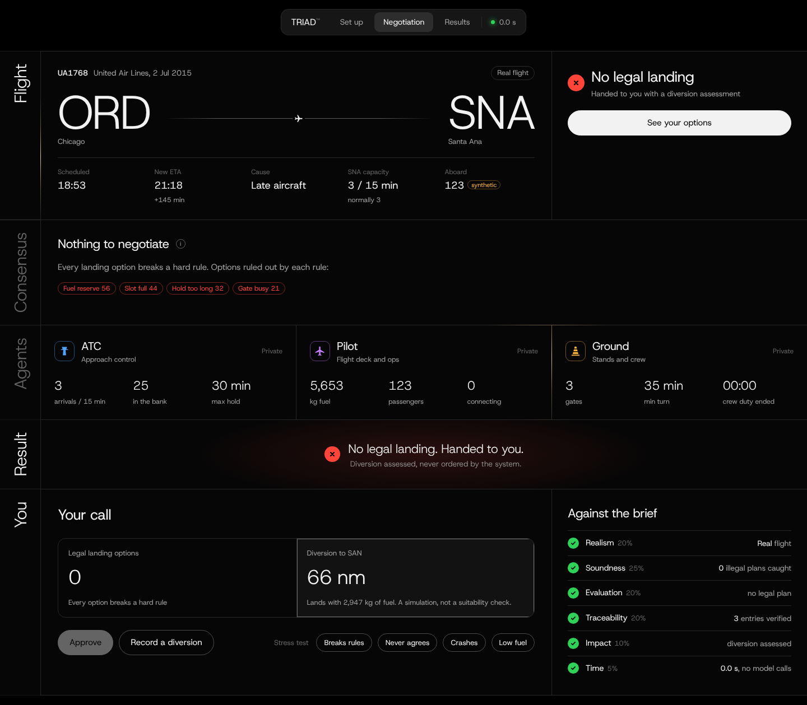
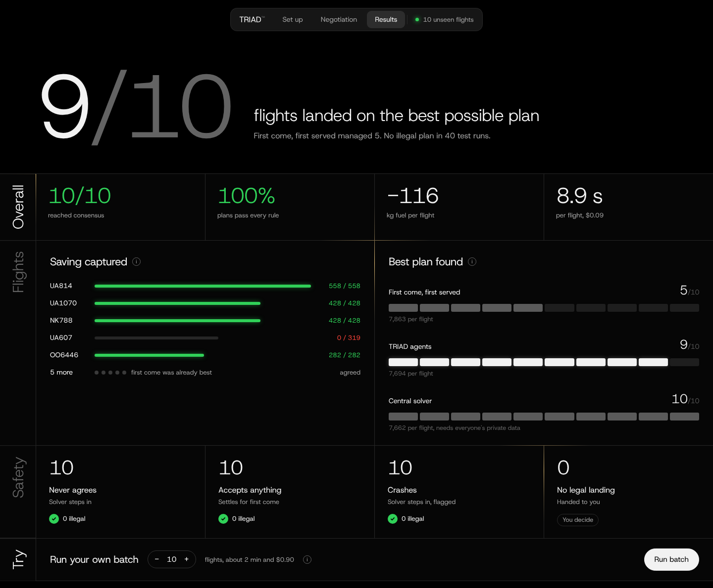

# TRIAD

Cross-organisational disruption negotiation for Airbus Challenge #2 (Autonomous SG 2026).

When a flight runs late, three organisations argue over it by phone — the ANSP, the operator
and the airport — each protecting its own numbers, and nobody can prove afterwards why the
outcome was the one chosen. Delay costs on the order of US$75–100 per aircraft-minute, holding
burns two tonnes of fuel an hour, and the knock-on reaches the next leg. A-CDM gives these
parties a shared timetable; it does not give them a way to negotiate.

TRIAD puts **ATC**, **Pilot/AOC** and **Ground** at one table. Three agents negotiate a revised
arrival slot, pilot action, gate and crew plan for a real delayed flight from the 2015 US DOT
on-time dataset, in at most three rounds, around a proposal the orchestrator owns. The OCC duty
manager approves or overrides the result; the system never executes anything.

**Design principle: agents reason, concede and explain; code decides what is legal, what it
costs, who wins a round, when consensus exists and when to fall back.**



## What sets it apart

Most multi-agent demos let the model decide the outcome. TRIAD does not.

* **Code is the referee.** Legality, cost, the round winner, consensus and fallback are all
  deterministic. A model can only propose, accept, reject with a rule id, or explain. A
  hallucinated option is rejected with the rule it breaks; an infeasible counter is caught
  every time, and the judge's ruling is on the record.
* **Measured against the truth, not against a story.** Every scenario has a FIFO status quo
  and a provably optimal solution enumerated from the full decision space. The evaluation runs
  30 seeded scenarios per arm and publishes the optimality gap, the fallback causes and the
  arms that lose.
* **Real data, labelled provenance.** Flights, delays and the next leg come from the DOT
  record; fuel, gates and crew are synthetic and every field says which it is.
* **Tamper-evident by construction.** Every message, verdict and human decision is appended
  to a SHA-256 hash-chained ledger that one command verifies and one command renders as an
  audit report. A solver fallback is flagged with a coded reason, never silent.
* **Adversaries built in.** Stubborn, reckless, flaky and crashing agent teams ship with the
  protocol and prove it holds without any model at all.

## Why this shape

The three organisations do not share data: the ANSP knows the arrival rate and the separation
picture, the operator knows the fuel and the connections, the airport knows the stands and the
crew clock. Each one optimises locally and in sequence.

TRIAD keeps those three views private and puts a *shared procedure* between them instead of a
shared database. Each party's agent sees only its own numbers and the structured decisions of
the others; the proposal it is asked about is checked by all three rule sets before it is ever
on the table; what it may not do is clear from the ruling it gets back. The things a safety
case needs to trust — legality, cost, who won, when to stop — are never delegated to a model.
The things a model is good at — weighing a trade-off, conceding on the right dimension,
explaining it in the other organisation's terms — are what the model is asked to do, and every
word of it is on the ledger for the duty manager.

Why not just the solver? The solver needs every party's cost function, which in practice no
party hands over. Here the solver is the *benchmark and the fallback*: it gives the honest
optimum to measure the negotiation against, and it decides, flagged, when the agents cannot.
If the live arm cannot beat FIFO the evaluation says so — that is the point of shipping it.

```
  DOT row  ──►  Scenario (real / derived / synthetic, labelled)
                   │
                   ▼
            enumerate every proposal  ──►  3 deterministic checkers (rule ids + sources)
                   │                        3 cost functions, public weights
                   ▼
            FIFO seed on the table
                   │
   ┌── round 1..3 ─┤  ATC ▸ PILOT ▸ GROUND answer in parallel: ACCEPT | COUNTER | REJECT(rule ids)
   │               │  judge: self-violation? unfounded reject? infeasible counter? concession?
   │               │  all ACCEPT → CONSENSUS ; else best feasible counter goes on the table
   └───────────────┤
                   ▼
   CONSENSUS  or  FALLBACK_SOLVER (coded reason)  or  UNRESOLVED (no legal landing)
                   │
                   ▼
   hash-chained ledger ──► dashboard ──► human APPROVE / OVERRIDE (legal options only) ──► ledger
```

## What is deterministic and what is a model

| Concern | Decided by | Where |
|---|---|---|
| Is a proposal legal for ATC / Pilot / Ground? | code — rule registry with regulatory sources | `rules.py`, `checkers.py` |
| What does it cost each party, and the system? | code — public weights | `costs.py` |
| What is the FIFO status quo, what is the optimum? | code — exhaustive over ≤ 200 proposals | `solver.py` |
| Which counter wins a round, is there consensus, when to stop | code | `judge.py` |
| Why should my organisation accept, counter or reject; what am I conceding; a rationale | model (or a scripted stub) | `agents.py`, `stubs.py` |
| Fallback when the model errs, stalls or the round cap is hit | code — same solver, flagged with a code | `judge.py` |
| Final approval | human | `api.py`, dashboard |

A proposal is `{slot, pilot_action, gate, crew_plan}` with `pilot_action ∈ SPEED_UP | CONTINUE |
REDUCE_SPEED | HOLD | DIVERT` and `crew_plan ∈ SAME_CREW | RESERVE_CREW`. Every proposal is run
through all eleven hard rules; each verdict records the measured value, the limit and the margin.

| Rule | Owner | Constraint | Source |
|---|---|---|---|
| `ATC-SLOT-CAP` | ATC | arrivals in the 15-min bin ≤ effective AAR | FAA JO 7210.3 ch.10 |
| `ATC-SEP-WAKE` | ATC | time-based wake separation fits inside the slot | ICAO Doc 4444 8.7.4; FAA JO 7110.65 5-5-4 |
| `ATC-HOLD-MAX` | ATC | airborne holding ≤ facility limit | facility directive (synthetic SOP) |
| `PLT-FUEL-RES` | Pilot | fuel after the action covers alternate + 45-min final reserve + contingency | 14 CFR 91.167(a); ICAO Annex 6 I 4.3.6 |
| `PLT-DIVERT-FUEL` | Pilot | fuel to the alternate with final reserve intact | 14 CFR 91.167(a)(2)-(3) |
| `PLT-TURB-HOLD` | Pilot | holding ≤ 10 min with moderate turbulence in the hold | operator FOM (synthetic SOP) |
| `GND-GATE-SIZE` | Ground | gate code accommodates the aircraft | ICAO Annex 14 reference code |
| `GND-GATE-FREE` | Ground | gate free for the whole stay plus buffer | stand allocation procedure (synthetic SOP) |
| `GND-CREW-DUTY` | Ground | next leg departs before the crew duty limit | 14 CFR Part 117 Table B |
| `GND-TURN-MIN` | Ground | turnaround ≥ type minimum | operator GOM (synthetic SOP) |
| `PUB-SCHEMA` | public | message matches the schema and references existing slots and gates | protocol |

Each party also has a cost function with public weights (ATC: bin pressure, holding workload,
speed-change and divert coordination; Pilot: fuel, arrival delay, missed connections,
turbulence exposure, diversion; Ground: gate change and release, remote bus, reserve-crew
call-out, crew overtime, next-leg delay or cancellation). A party's **utility** for a legal option is normalised over the
feasible set — 1 is its cheapest legal option, 0 its dearest — and an option is **mutually
acceptable** when every party's utility is at least `ACCEPTANCE_THRESHOLD` (0.35). That set is
what the live arm is measured on: consensus only counts for something when such an option exists.

A model reply is a structured message (`ACCEPT | COUNTER(proposal) | REJECT(rule_ids)` plus
concessions, rationale, confidence). The judge then checks it:

| Ruling | Meaning |
|---|---|
| `ACCEPT_OK` | accepted a proposal that passes the accepter's own rules |
| `SELF_VIOLATION` | tried to accept a proposal that fails its own hard rules — refused |
| `REJECT_OK` | rejected citing a rule the proposal really fails |
| `UNFOUNDED_REJECT` | cited rules the proposal passes — counted as a plain non-accept |
| `REJECT_PREFERENCE` | rejected without a rule — legitimate, counts against consensus |
| `COUNTER_OK` | feasible counter that is a concession; candidate to go on the table |
| `INFEASIBLE_COUNTER` | fails any party's checker (or references nothing) — discarded, rules logged |
| `NON_CONCESSION` | cheaper for the proposer than its last counter — discarded |
| `REGRESSIVE_COUNTER` | dearer for the system than the table, and does not lift the worst-off party within FIFO cost — discarded |
| `LATE_COUNTER` | counter in the final round, which only votes — ignored |

Consensus is three explicit `ACCEPT`s in one round. Otherwise the feasible, conceding,
non-regressive counter with the lowest system cost (mutually acceptable first, tie → earliest
slot) goes on the table. The table is therefore monotone: starting from FIFO, system cost
never rises except for a fairness move that lifts the worst-off party and stays within FIFO
cost, so a negotiated decision is never dearer for the system than the status quo — the
evaluation checks that invariant end to end. After the round cap, two abstains by one agent, or any agent error, the solver's
optimum is used and the outcome carries a `fallback_code`:
`NO_CONSENSUS_ROUND_CAP | NO_ACCEPTABLE_OPTION | AGENT_ABSTAINED | AGENT_ERROR | NO_FEASIBLE_LANDING`.
`DIVERT` is never negotiated: when no landing option is legal the outcome is `UNRESOLVED` with
a diversion assessment for the duty manager. That assessment is a simulation over the synthetic
fuel figures and the nearest airport by distance — it is not evidence that the alternate is
suitable.

### What reaches a prompt

Each round the judge freezes all three views before the three calls go out in parallel, so no
agent's answer in a round can enter another's prompt in that round. A view holds the party's
own private state and verdicts, the proposal on the table, its shortlist of legal options
(with its own costs and utility), and the public log. The shortlist is the party's ten cheapest
legal options plus the five cheapest for the system and the Pareto frontier of the three party
costs — both computed from the public weights, so nothing private leaks — which guarantees the
optimum is on every party's list and no agent can miss it merely because it was not among its
own ten cheapest. Other parties appear in the public log
only as **structured fields** — decision, proposal key, cited rule ids, and the judge's ruling
with its reason. Their free-text rationale is written to the ledger for the duty manager and is
never replayed into another agent's prompt, so one model's output cannot become instructions
to another; an agent sees only its own earlier prose. The orchestrator never holds raw private
data from any party, only verdicts (`rule_id, ok, measured, limit, margin`) and scalar costs.

A model call has one schema repair at most. A provider error (timeout, API failure) abstains
immediately without a repair call; SDK-level retries default to 0 and the timeout to 30 s
(`TRIAD_MODEL_MAX_RETRIES`, `TRIAD_MODEL_TIMEOUT_S`). Two abstains by one agent end the run on
the solver with `AGENT_ABSTAINED` or `AGENT_ERROR`.

Every state change is one entry in a SHA-256 hash-chained JSONL ledger: scenario, options
each party saw, each message with the model id / prompt hash / tokens / latency behind it,
each ruling with the measured-vs-limit verdicts, each round result with the rule that chose
the next proposal, the decision, and the human step. `triad verify` and the dashboard
recompute the chain; `triad audit` rebuilds a Markdown report from the file alone. A hash chain
cannot see lines cut from the end, so each append also rewrites a head anchor beside the ledger
(`<name>.head`, entry count and head hash) and `verify` checks the file against it. The anchor
lives next to the ledger, so it catches accidents and naive edits; against a determined editor,
keep the head hash that `triad negotiate` and the API report somewhere else. Appends are
serialised with a lock, so the worker thread and a human decision can never interleave.

## Setup

```bash
python3 -m venv .venv
.venv/bin/pip install -e ".[dev]"
cp .env.example .env            # add ANTHROPIC_API_KEY for live agents; stubs need none
                                # model id: TRIAD_MODEL (AGENT_MODEL also read)
```

Place the datasets in `data/` (not committed):

```
data/flights.csv     # 2015 US DOT flight delays and cancellations (~590 MB)
data/airlines.csv
data/airports.csv
```

Then build the parquet cache once: `.venv/bin/python scripts/build_parquet.py`.

## Usage

```bash
triad scenario --seed 29                 # one disruption, with provenance labels
triad solve --seed 29                    # decision space, FIFO and optimum
triad negotiate --seed 29 --stub yielding   # full protocol with scripted agents, no API
triad negotiate --seed 29                # live model agents (TRIAD_MODEL, default claude-sonnet-5-5)
triad verify runs/EV4636-2015-01-07.ledger.jsonl
triad audit  runs/EV4636-2015-01-07.ledger.jsonl > audit.md
triad eval --arms greedy yielding agreeable stubborn          # 30 seeds, 4 stub arms
triad eval --arms yielding llm:claude-sonnet-5-5 -n 20
triad serve                              # dashboard at http://127.0.0.1:8000
pytest
```

Demo seeds are `29, 7, 101`; evaluation seeds start at 1000 and never overlap them.

Stub policies: `greedy` (counters with its cheapest option until the table is within
tolerance), `yielding` (concedes progressively), `agreeable` (accepts anything legal),
`stubborn` (never accepts), `reckless` (accepts anything, even what fails its own rules; the
judge refuses that as `SELF_VIOLATION`, which only shows when the proposal on the table is
illegal for that party, so the unit tests drive it directly), `flaky`
(fails the schema once), `broken` (never produces a valid message), `crashing` (raises, like a
provider timeout). They exist to exercise every path of the judge without a model, and to give
the model arms something to be compared against.

## Dashboard and API

`triad serve` starts FastAPI with the single-page console at http://127.0.0.1:8000. It has
three views.

**Set up.** Pick one of the demo flights (seeds `7`, `29`, `101`), each tagged with the party
whose rules block the most options, or type any seed. *Normal agents* runs the live model
agents. *Stress test* runs scripted agents instead (below).



**Negotiation.** `POST /api/runs` starts a negotiation in a worker thread and
`GET /api/runs/{id}/events` streams every ledger entry over SSE as it is written, so the page
fills in round by round. It shows the flight with its provenance tags, how each agent's utility
moved as the plan on the table changed, each agent's private numbers, and every move with the
judge's ruling under it. A counter that breaks another party's rule is shown as rejected by
code, with the rule ids (hover for the measured value and the limit). The agent's own
reasoning and concessions open on click.



When the run ends, the duty manager compares the result with first come, first served and the
optimum, then **Approves** it or chooses another plan from the *legal* options only. The API
refuses an override that fails a hard rule and names the failing rules. When nothing can land,
the choice is to record a diversion. The human step is appended to the same chain as
`HUMAN_DECISION`, actor `USER`. Only one human decision is accepted per run, even under
simultaneous clicks. The API has no authentication, so `actor` is whatever the client sent;
the entry records `actor_authenticated: false` and should be read that way.
`/api/runs/{id}/audit.md|.json|verify` download the trail.

**Results.** Shows the latest `triad eval` summary from `/api/eval`. It can also run its own
batch from the browser over the evaluation seeds, with the live agents plus never-agrees,
accepts-anything and crashing scripted teams, to fill in the flight-by-flight view (see
Evaluation).

**Stress tests** sit on the Set up view and under *Your call*. They map onto the scripted
policies: *Breaks rules* is `greedy`, *Never agrees* is `stubborn`, *Crashes* is `crashing`, and
*Low fuel* runs seed `1021` (UA1768), a real flight on which no landing option is legal.

### What to look at in a demo

1. **Set up**: AA1495 (seed `7`), *Normal agents*, *Start negotiation*. The ticket tags the
   synthetic fields, and Las Vegas is taking 6 arrivals per 15 minutes instead of 9.
2. **Round 1**: in the run pictured, the Pilot counters with the 16:45 slot, which it cannot
   know is full. Code rejects it with `ATC-SLOT-CAP` and `ATC-SEP-WAKE` (hover the tags). ATC's
   slow-down counter is legal and the cheapest, so code puts it on the table. Model output
   varies from run to run, and the rulings show whatever happened.
3. **Round 2**: three `ACCEPT_OK` give `CONSENSUS`. The chart shows ATC and Pilot utility
   rising from 0.80 and 0.72 to 1.
4. **Your call**: 10,204 against 10,685 for first come, first served, with the solver's optimum
   also at 10,204. Approve, or choose another legal plan. *Against the brief* shows the ledger
   verified against its head anchor.
5. **Stress test**: *Never agrees* ends on the solver with `NO_CONSENSUS_ROUND_CAP`, and
   *Crashes* with `AGENT_ERROR`. The system degrades to a flagged deterministic answer, never to
   silence. *Low fuel* has no legal landing, so the outcome is `UNRESOLVED` and the duty
   manager gets a diversion assessment.
6. **Results**: the batch view, flight by flight.



## Evaluation

`triad eval` runs arms over disjoint seeds with a thread pool and writes
`runs/eval/<tag>/{rows.jsonl, summary.json, summary.md}` plus every ledger. Metrics:
consensus rate (overall and given an option exists that clears every party's threshold),
fallback codes, counters attempted vs infeasible counters caught, whether the final decision
passes all checkers (must be 1.00), whether the final decision is ever dearer than FIFO (must
be 0), gap to the optimum and saving vs FIFO with bootstrap 95 % intervals over the shared
seeds, the same figures on consensus runs only (so a non-cooperating arm cannot score on the
solver's work), an attribution of every consensus run that missed the optimum (not visible to
any party / visible but never proposed / proposed but lost the round / on the table and voted
down), per-party minimum utility, rounds, wall time, model calls, tokens and an estimated USD
per run.

The dashboard's Results view shows the same measures. The live arm from 31 October ran ten
unseen flights (seeds 1000 to 1009) with Claude Opus 5.5 as all three agents. The agents
reached the best plan on 9 of 10, but first come, first served was already best on 5 of
those, so the real test is the other 5. There the agents captured the full saving on 4 and
settled for first come, first served on UA607. The safety row is the scripted teams on the
same flights.



Stub arms over 30 seeds (`runs/eval/stubs-30`, reproducible with `triad eval --tag stubs-30`):

| | agreeable | greedy | yielding | stubborn |
|---|---|---|---|---|
| consensus rate | 0.97 | 0.90 | 0.90 | 0.00 |
| counters attempted / infeasible caught | 0 / 0 | 95 / 81 | 95 / 79 | 174 / 144 |
| regressive counters discarded | 0 | 10 | 9 | 10 |
| final decision passes all checkers | 1.00 | 1.00 | 1.00 | 1.00 |
| final never dearer than FIFO | 1.00 | 1.00 | 1.00 | 1.00 |
| gap to optimum, mean [95 % CI] | 257 [155, 371] | 151 [84, 227] | 142 [75, 220] | 0 |
| saving vs FIFO, mean [95 % CI] | 0 | 107 [20, 214] | 115 [27, 225] | 257 |
| share of runs at optimum | 0.38 | 0.48 | 0.55 | 1.00 |
| consensus runs only: saving vs FIFO | 0 | 83 | 93 | – |
| why consensus missed the optimum | not proposed 18 | not proposed 15 | not proposed 13 | – |

Read honestly: `agreeable` reaches consensus on the FIFO seed every time, which is vacuous;
`stubborn` scores a perfect gap only because the solver decides every time, which is why the
consensus-only row exists. `greedy` and `yielding` now beat FIFO with intervals that exclude
zero; before the no-regression rule they lost to it (−188 and −104), because a legal conceding
counter could win a round while being dearer for the system than the table. Every remaining
gap has the same cause: the optimum was on all three shortlists and nobody proposed it — the
stubs counter by their own cost alone, by design. That is the headroom the live arm is
measured against, and its numbers are only meaningful when produced with a key — see Limits.

## Limits and caveats

* **Synthetic fields.** Fuel on board, burn rates, gate map and occupancy, pax connection
  counts, crew duty end and aircraft type are seeded from the row and labelled `synthetic`
  in the scenario, the UI and the ledger. Flight, delay breakdown, arrival bank, next leg of
  the same tail and nominal arrival rate are `real` or `derived` from the 2015 data.
* **Cost weights are public assumptions**, not airline figures; the system cost is in
  USD-like units. Utilities are normalised per party over the feasible set, so a utility of
  1 means "my cheapest legal option", not "free".
* **Consensus can be vacuous** (see above); the gap to the optimum, the saving vs FIFO and
  their consensus-only versions are the honest measures.
* **No live model results are shipped unless a key was available when the evaluation ran.**
  Without `ANTHROPIC_API_KEY` the live agents abstain, the judge records `AGENT_ERROR` and the
  solver decides — the system degrades to a flagged deterministic answer rather than
  pretending.
* **Dollar figures per run are estimates** from list prices in `config.PRICES_PER_MTOK`.
* 2015 data, single disrupted flight at a time, no A-CDM integration, model latency of a few
  seconds per round.

## Layout

```
triad/
  data.py       DuckDB queries over the DOT dataset (one cursor per thread)
  scenario.py   scenario assembly with real / derived / synthetic provenance
  proposal.py   proposal fields, enumeration and derived timings
  rules.py      rule registry (id, owner, title, source)
  checkers.py   per-party deterministic checkers → verdicts (measured, limit, margin)
  costs.py      per-party cost functions, public weights
  solver.py     feasible set, FIFO baseline, optimum
  config.py     model ids, timeouts, weights, thresholds (env-overridable)
  messages.py   strict message schema and the view each agent receives
  views.py      per-party private state and option rendering
  judge.py      round rulings, consensus, fallback, utilities, ledger writes
  protocol.py   parallel ask / retry / abstain loop around the judge
  agents.py     live model agents (structured output, forced-tool fallback, telemetry)
  stubs.py      scripted agents for tests and evaluation baselines
  ledger.py     hash-chained JSONL ledger and verification
  audit.py      Markdown audit report from a ledger
  eval.py       batch evaluation over arms and seeds
  api.py        FastAPI service: runs, SSE stream, options, human decision, audit
  static/       dashboard
  cli.py        triad scenario | solve | negotiate | verify | audit | eval | serve
tests/          124 tests: checkers, solver, ledger tamper, judge paths, agents with a fake
                client, eval harness, audit and API end to end
```

See [PLAN.md](PLAN.md) for the original design and rubric mapping.
